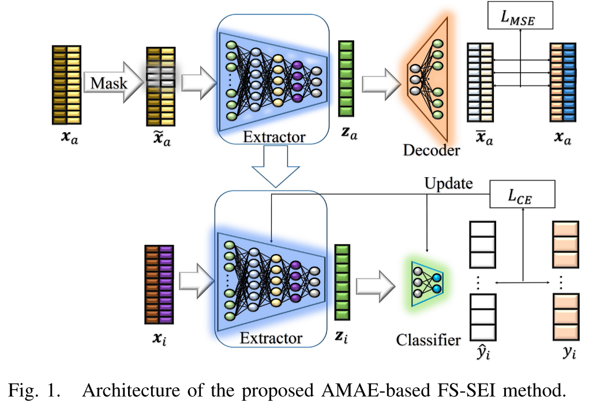
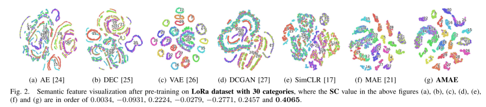
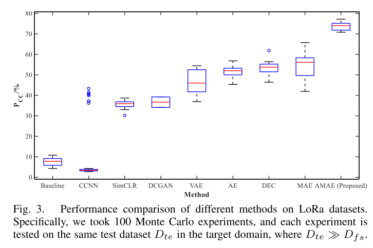

# Radiation Source Separation: Few-shot Target Recognition Based on Asymmetric Mask Autoencoder with Python Code

Introduction With the widespread adoption of mobile communication devices and the booming development of the Internet of Things, advanced wireless technologies are ubiquitous in our daily lives and indispensable[1]. However, due to the openness of wireless networks, they are vulnerable to large-scale malicious attacks, making their security issues undeniable[2]. Radio Frequency Fingerprinting (RFF) has the characteristic of hardware differences between wireless devices[3]. By analyzing received radio frequency (RF) signals, we can extract subtle features from different devices. Specific Emitter Identification (SEI) utilizes RFF to identify inherent characteristics of different wireless devices[4].
To address this challenge, Yang et al. [12] and Huang et al. [13] introduced the Few-Shot Meta Learning (FS-SEI) method based on Meta learning. Wang et al. [14] used Long Short-Term Memory (LSTM) and transfer learning to solve the FS-SEI problem. However, these pre-training methods require labeled samples, while meta learning requires building thousands of tasks, which requires substantial computational costs and longer training times.
Fortunately, semi-supervised learning methods that use unlabeled samples for unsupervised pretraining and labeled samples for fine-tuning can be used to address the FSSEI problem. Regarding comparisons with unsupervised methods, Zha et al. [15] introduced a curriculum learning framework pretraining method using pseudo labels for improving recognition performance. Wu et al. [16] and Zhao et al. [17] used a two-stage semi-supervised training scheme, first through contrastive learning for training, and then for fine-tuning on labeled samples. Additionally, generative unsupervised methods can also be used for pretraining. Xie et al. [18] and Zhou et al. [19] used autoencoders (AE) for pretraining followed by supervised fine-tuning. Gong et al. [20] proposed an unsupervised SEI framework based on information maximization generative adversarial networks (InfoGAN) and RFF embeddings. Huang et al. [21] used a symmetric mask autoencoder (MAE) architecture, and ResNet as the backbone network for unsupervised pretraining, followed by fine-tuning on different data sizes. However, they pointed out that the ResNet architecture is not suitable for learning long-range dependencies and has a larger model size. Moreover, using a symmetric decoder brings more computational cost.
To address the issues of model lightweightness and good identification performance, we propose a FS-SEI identification method based on an asymmetric mask autoencoder (AMAE). The main contributions of this letter are as follows.
· We proposed an self-supervised learning method based on AMAE for pretraining the RFF extractor, which has better feature extraction performance and stronger generalization ability in the target domain.
· We transferred the pretrained RFF extractor to the target domain, only using a small number of labeled samples for fine-tuning. At the same time, we trained a simple classifier that contains only one convolutional layer, for classifying the RFF features of FS-SEI.
· We evaluated the proposed FS-SEI method on the LoRa dataset and WiFi dataset. The experimental results show that the new method is significantly better than similar methods, with good recognition performance.
The article includes illustrations.
Conclusion: This paper proposes an effective FS-SEI method based on AMAE, which addresses the issue of difficulty in obtaining signal labels in non-cooperative scenarios. Specifically, we select CVCNN as the backbone network for RFF extraction and use the AMAE architecture for iterative updates. Subsequently, we transfer the feature extraction performance of the RFF extractor with good capabilities to a limited labeled target domain for fine-tuning, hoping to achieve better generalization performance in this target domain. In the pre-training phase, compared with other unsupervised methods, the proposed FS-SEI method based on AMAE has the best feature extraction capability, where features have more compact intra-class distances and more separable inter-class distances. In the fine-tuning phase, the performance of the FS-SEI method based on AMAE is the most stable, with the highest average ACC, reaching 70.06% and 92.68% on the LoRa dataset's 30-to-10-shot points and WiFi dataset's 30-to-10-shot points, respectively. At the same time, it proves the effectiveness and lightweight nature of CVCNN as the main backbone network.

## Images

<!-- PAYMENT_BLOCK -->

## Get this dataset

- Payment link (Stripe): [Buy now](https://buy.stripe.com/3cs8yP7sY87d0vu9AB)
- Payment QR code: 

<!-- /PAYMENT_BLOCK -->
